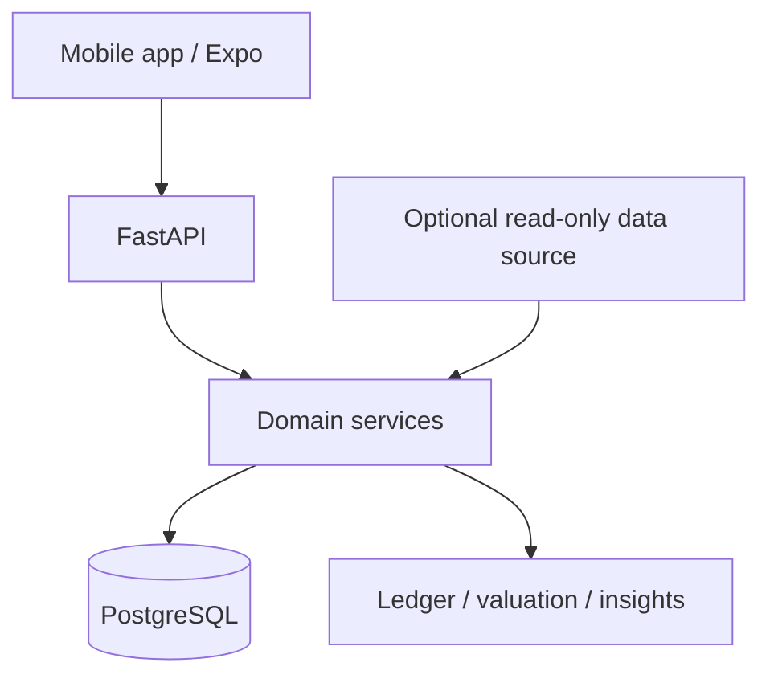

# Finance Agent

**개인 금융 데이터의 정확성과 감사 가능성을 우선한 금융 관리 시스템**  
**상태:** V0.7 모바일 MVP 구현 및 Android 실기기 검증 완료 · AI 분석은 후속 개발 예정  
[← 프로젝트 목록](../../README.md)

## Problem

지출, 신용카드 부채, 계좌이체, 대출, 투자자산을 각각 다른 기준으로 관리하면 실제 소비와 순자산을 일관되게 설명하기 어렵습니다. 특히 지인 정산과 카드대금 납부를 다시 지출로 계산하면 숫자가 왜곡될 수 있습니다.

**Goal:** 거래의 의미와 시점을 보존하면서 생활 금융·투자·대출을 통합 조회할 수 있는 개인 금융 시스템.

## Verified implementation

- 복식부기 기반 거래 원장: Opening, Income, Expense, Reimbursement, Refund, Transfer, CardPayment
- 정정·취소 기록을 남기는 append-only correction 및 감사 이력
- 멱등성 키를 사용한 중복 금융 요청 처리
- 계좌 잔액, 일별 흐름, 월간 보고서, 대출 잔액·원리금 내역
- 투자 자산의 보유 수량, 가격·환율 기반 평가, 순자산 요약
- 선택적 읽기 전용 외부 증권 데이터 연동 및 명시적 데이터 출처 전환
- Expo 모바일 앱의 주요 금융 입력·조회 흐름과 실기기 검증

## Architecture & stack

| Layer | Approach |
|---|---|
| Mobile | React Native / Expo |
| API | Python / FastAPI |
| Domain / persistence | SQLAlchemy / Alembic |
| Storage | PostgreSQL / Neon |
| Deployment | Cloud Run 기반 API |
| Quality | 백엔드 자동화 테스트, 데이터 정합성·마이그레이션 검증 |

## Important decisions

1. **원장 잔액과 실제 금융기관 잔액을 혼동하지 않습니다.** 기록으로 계산한 숫자의 한계를 명시합니다.
2. **수정 시 원본을 덮어쓰지 않습니다.** 거래의 변경 과정을 추적 가능하게 유지합니다.
3. **누락된 시세·환율을 0으로 채우지 않습니다.** 불완전한 투자 평가는 불완전한 결과로 표시합니다.
4. **금융 계산과 AI 설명을 분리합니다.** 정확한 계산은 금융 도메인 로직이 담당합니다.

## Roadmap

- **Implemented / validated:** V0.7 실사용 모바일 MVP 및 기능 검증
- **Planned:** V0.8 AI 설명·자연어 분석, V0.9 연말정산 계산 확대, V1.0 안정화

## Portfolio boundary

원본 코드 저장소와 개인 금융 데이터는 비공개입니다. 공개 데모는 아직 제공하지 않으며, 이 문서는 설계·개발 경험을 설명하기 위한 요약입니다. 금융기관의 공식 서비스가 아닙니다.
