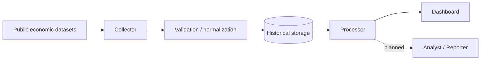

# Investment Intelligence

**경제 데이터의 수집·정규화·품질 검증과 분석 자동화 프로젝트**  
**상태:** 수집기와 보호된 대시보드 운영 · Processor 일부 구현 · Analyst/Reporter 계획 단계  
[← 프로젝트 목록](../../README.md)

## Problem

국채금리와 물가 등 경제지표는 출처와 갱신주기, 수정 이력이 다릅니다. 단순히 숫자를 모으는 데서 그치지 않고 어떤 자료를 언제 수집했는지 기록하고, 신뢰할 수 있는 분석 기반을 구축하는 것이 목표입니다.

## Implemented / confirmed

- 미국 국채금리(2년·10년·30년)와 장단기 금리차 계산
- 소비자물가 공공 API 수집기 및 검증 흐름 구축
- 수집 실행 이력, 관측값, 수정 이력, 중복 데이터 처리
- GitHub Actions 기반 수동·예약 수집 체계
- 인증된 읽기 전용 시장 데이터 대시보드 V1 운영 확인
- Collector/Processor/Analyst/Reporter의 역할과 실행 상태 구분

## Architecture & stack

| Layer | Approach |
|---|---|
| Ingestion | Python, 공식 경제 데이터 API |
| Orchestration | GitHub Actions |
| Storage | PostgreSQL / Neon |
| Dashboard | React / Vite, Cloudflare Workers |
| Controls | 인증 경계, read-only API, 수집 결과 상태 관리 |

## Important decisions

- 무료·공식 공개 데이터를 우선 활용하고, 소스별 수집 품질을 평가합니다.
- 원시 관측과 파생 계산, 이력 기록을 분리해 재현성을 확보합니다.
- 배포 여부와 코드 구현 여부를 구분해 과장하지 않습니다.
- 개인정보 및 접근권한이 필요한 운영 환경은 포트폴리오와 분리합니다.

## Roadmap / status boundaries

- **Operational:** 인증된 시장 데이터 대시보드 V1
- **Implemented but not yet production-deployed:** Processor 요약 API/UI 일부 기능
- **Opt-in / not enabled by default:** Collector 실행 활동 기록
- **Not implemented:** Analyst, Reporter, 자동 AI 투자 해석/추천

## Portfolio boundary

개인 투자계좌, 운영 DB 주소, 연결 계정, 인증 토큰과 접근 통제된 대시보드 URL은 공개하지 않습니다. 본 프로젝트는 투자 권유 서비스가 아닌 개인 데이터 엔지니어링 프로젝트입니다.
