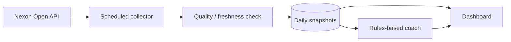

# MapleStory AI Coach

**공개 게임 API를 활용한 데이터 수집·성장 기록·설명 가능한 추천 시스템**  
**상태:** 일별 수집·추천 로직 구현 · 운영 배포 E2E 검증 일부 진행 중  
[← 프로젝트 목록](../../README.md)

## Problem

캐릭터의 성장 상태는 레벨, 장비, 유니온, 각종 기간제 효과에 흩어져 있고, 시간에 따른 변화를 직접 추적하기 어렵습니다. 기록된 데이터에 근거해 현재 상태와 다음 성장 과제를 설명하는 개인용 코치를 목표로 합니다.

## Implemented / verified in development

- Nexon Open API 기반 PC 메이플스토리 데이터 수집
- GitHub Actions 일별 수집·상태 확인 및 지연/부분 성공 탐지
- 날짜별 스냅샷·PostgreSQL 저장·중복 처리
- 캐릭터 현황·수집 최신성 정보를 확인하는 대시보드/API 구현
- 목표, 플레이 시간, 장비·심볼 관측을 반영한 **규칙 기반** 개인화 TOP 3 추천
- 근거·데이터 누락·추천 상태 이력을 구분하는 검증 로직
- 기존 MapleStory M 실험을 보존하면서 PC MapleStory 중심으로 전환

## Architecture & stack

| Layer | Approach |
|---|---|
| Source | Nexon Open API |
| Data pipeline | Python, GitHub Actions |
| Persistence | PostgreSQL / Neon |
| Web/API | Cloudflare Workers 중심 |
| Quality | 수집 최신성 검사, 단위/통합 테스트 |

## Important decisions

1. API 응답의 **관측 날짜**와 DB의 **저장 시각**을 구분합니다.
2. API 미제공, 조건 미충족, 부분 성공, 요청 실패를 서로 다른 상태로 표시합니다.
3. 비용이나 전투력 효과에 근거가 부족하면 임의의 수치를 만들지 않습니다.
4. 복잡한 LLM보다 재현 가능한 규칙 기반 추천을 먼저 구현합니다.

## Remaining validation / next steps

- 인증된 실제 운영 API 및 데이터 연결의 end-to-end 검증
- 실제 플레이 변화와 추천 성과의 연결 확인
- 개인정보·이용약관을 검토한 공개용 샘플 화면과 성장 기록 준비

## Portfolio boundary

실제 게임 계정 정보, 캐릭터 식별자, API 키, 비공개 게임 데이터와 인증된 운영 URL은 게시하지 않습니다. 넥슨의 공식 서비스가 아닌 개인 프로젝트입니다.
